<p align="center">
  
</p>

# ⚡ Awesome Real-Time Customer Data Platform (CDP)

<p align="center">
  <a href="https://github.com/ishandutta2007/Awesome-Awesome-Awesome"></a>
  <a href="https://discord.gg/jc4xtF58Ve"></a>
  <a href="https://github.com/ishandutta2007/Awesome-Real-Time-Customer-Data-Platform/stargazers"></a>
  <a href="https://github.com/ishandutta2007/Awesome-Real-Time-Customer-Data-Platform/network/members"></a>
  <a href="https://github.com/ishandutta2007"></a>
</p>

## 🚀 Curated Real-Time Customer Data Platforms & Open-Source CDP Ecosystem

**A comprehensive, SEO-optimized directory of enterprise SaaS Customer Data Platforms (CDPs), event streaming pipelines, composable CDP engines, and self-hosted open-source customer 360 frameworks.**

*Focused on Real-Time Customer Data Platforms (CDP), Identity Resolution, Reverse ETL, Behavioral Event Streaming, Customer 360 Profiling, Data Activation, and Privacy Compliance.*

**Last updated: October 2026** 📅

---

### 💡 Overview & SEO Guide

A **Real-Time Customer Data Platform (CDP)** collects, unifies, and enriches first-party customer behavioral data across web, mobile, server, and IoT channels in sub-second latency. Modern CDPs solve identity resolution, maintain persistent Golden Customer Records (Customer 360), and activate enriched audiences back into advertising, marketing automation, CRM, and analytics platforms via real-time webhooks and Reverse ETL.

Whether you are evaluating hyperscale enterprise SaaS suites (Salesforce Data Cloud, Twilio Segment, Adobe Real-Time CDP) or deploying private, privacy-first open-source engines (PostHog, RudderStack, Snowplow, Apache Unomi, Jitsu), this curated guide covers architecture, transparent pricing tiers, free tier limits, and valuation benchmarks.

---

## 📑 Table of Contents

- [🏢 Commercial SaaS & Hosted Platforms](#-commercial-saas--hosted-platforms)
- [🔓 Open-Source GitHub Projects](#-open-source-github-projects)
  - [⚡ Customer Data Infrastructure & Segment Alternatives](#-customer-data-infrastructure--segment-alternatives)
  - [📊 Product Analytics & User Journey Platforms](#-product-analytics--user-journey-platforms)
  - [🔄 Data Ingestion & Integration Engines](#-data-ingestion--integration-engines)
- [🎯 Key Architectural Components of a Real-Time CDP](#-key-architectural-components-of-a-real-time-cdp)
- [🤝 How to Contribute](#-how-to-contribute)
- [💖 Support & Sponsorship](#-support--sponsorship)
- [⭐ Star History](#-star-history)
- [⚠️ Disclaimer](#%EF%B8%8F-disclaimer)

---

## 🏢 Commercial SaaS & Hosted Platforms

The global Customer Data Platform (CDP) market size is estimated at **$7.4 billion in 2026** and is projected to reach **$28.2 billion by 2031** (CAGR ~30.6%). The sector is **moderately fragmented**, characterized by ongoing consolidation where cloud hyperscalers and CRM giants (Salesforce, Adobe, Twilio) capture high-volume enterprise workloads, while specialized and composable pure-play vendors (Tealium, ActionIQ, Amperity, mParticle) compete aggressively on advanced identity resolution, zero-copy architecture, and industry verticalization.

| Platform | Description & Key Capabilities | Starting Pricing | Free Tier / Trial Limit | Company Size (Valuation / Market Cap / Revenue) |
| :--- | :--- | :--- | :--- | :--- |
| **[Salesforce Data Cloud](https://www.salesforce.com/data/)** ☁️ | Hyperscale real-time customer data engine natively embedded in Salesforce CRM, Einstein AI agents, and Tableau. Supports zero-copy federation with Snowflake and Databricks. | $108,000/year ($9,000/month for Enterprise Starter edition) | 30-day free trial (Data Cloud Developer edition trial / Trailhead sandbox) | Market Cap: **$280 Billion** (Parent: Salesforce, Inc.; Annual Rev: $38.0B+) |
| **[Adobe Real-Time CDP](https://business.adobe.com/products/real-time-customer-data-platform/RTCDP.html)** 🎨 | Enterprise B2C and B2B customer profile platform built on Adobe Experience Platform (AEP), streaming real-time profile lookups and edge segmentation. | $60,000/year (Estimated starting contract for Prime tier) | 30-day guided enterprise sandbox / Proof-of-concept trial | Market Cap: **$230 Billion** (Parent: Adobe Inc.; Annual Rev: $21.5B+) |
| **[Twilio Segment](https://segment.com/)** 🔄 | Leading customer data infrastructure (CDI) platform for tracking, cleaning, and routing customer event streams to 450+ downstream tools. | $120/month (Team plan, billed annually) | Free forever plan (up to 1,000 Monthly Tracked Users and 2 data sources) | Market Cap: **$11.5 Billion** (Parent: Twilio Inc.; Segment acquired for $3.2B) |
| **[Treasure Data](https://www.treasuredata.com/)** 💎 | Enterprise Customer Data Cloud with security governance, omni-channel identity stitching, and predictive customer journey orchestration. | $42,000/year (Estimated starting contract for Foundation package) | 14-day enterprise trial environment (up to 500k event records limit) | Valuation: **$1.4 Billion** (Parent: SoftBank Corp. affiliate; Total Funding: $234M+) |
| **[Tealium AudienceStream CDP](https://tealium.com/)** 🌐 | Real-time customer data hub and audience orchestration engine built on Tealium iQ tag management with patented visitor stitching algorithms. | $36,000/year (Estimated entry enterprise contract) | 30-day proof-of-concept sandbox trial upon vendor qualification | Valuation: **$1.2 Billion** (Series G unicorn; Total Funding: $165M+) |
| **[mParticle](https://www.mparticle.com/)** 📱 | Multi-channel customer data platform specialized in native mobile app SDKs, streaming data pipelines, privacy controls, and AI segment triggers. | $24,000/year ($2,000/month estimated entry growth tier) | 30-day free trial (up to 100,000 Monthly Active Users sandbox limit) | Valuation: **$750 Million** (Total Funding: $272M+; Series E) |
| **[ActionIQ](https://www.actioniq.com/)** ⚡ | Hybrid composable CDP with InfiniteCompute architecture, giving business users self-serve audience segmentation directly atop cloud data warehouses. | $50,000/year (Estimated entry contract for composable modules) | 14-day interactive guided product tour / 30-day POV sandbox | Valuation: **$450 Million** (Total Funding: $145M+; Series C) |
| **[Amperity](https://amperity.com/)** 🧠 | AI/ML-driven enterprise identity resolution CDP that cleans, deduplicates, and resolves ambiguous customer records without deterministic matching keys. | $60,000/year (Estimated base enterprise subscription) | 30-day custom enterprise pilot / sandbox trial | Valuation: **$400 Million** (Total Funding: $187M+; Series D) |
| **[BlueConic](https://www.blueconic.com/)** 🎯 | Pure-play real-time customer data platform designed for marketing and growth teams to build unified first-party profiles and trigger real-time on-site dialogues. | $35,000/year (Estimated starting tier for standard customer profiles) | 14-day free trial (Sandbox access with synthetic audience demo data) | Acquisition Value: **$300 Million** (Acquired majority stake by Vista Equity Partners) |

---

## 🔓 Open-Source GitHub Projects

Curated list of open-source real-time customer data platforms, event collection infrastructures, privacy-first web/product analytics, and reverse ETL ingestion frameworks.

> Repositories are ranked in descending order by GitHub stargazers count.

### ⚡ Customer Data Infrastructure & Segment Alternatives

- **[PostHog](https://github.com/PostHog/posthog)** [](https://github.com/PostHog/posthog/stargazers) 🦔
  - *All-in-one product analytics suite, event ingestion pipeline, session replays, feature flags, A/B testing, and real-time customer data warehouse.*
  - **License:** MIT / PostHog EE
- **[Snowplow](https://github.com/snowplow/snowplow)** [](https://github.com/snowplow/snowplow/stargazers) ❄️
  - *Enterprise-grade customer data infrastructure for generating, validating, and enriching real-time behavioral event streams at petabyte scale.*
  - **License:** Apache-2.0 / Snowplow Limited
- **[Jitsu](https://github.com/jitsucom/jitsu)** [](https://github.com/jitsucom/jitsu/stargazers) 🚀
  - *Open-source Segment alternative. Fully scriptable data ingestion engine, real-time event streaming, transformation functions, and data destination routing.*
  - **License:** MIT
- **[RudderStack (rudder-server)](https://github.com/rudderlabs/rudder-server)** [](https://github.com/rudderlabs/rudder-server/stargazers) ⚓
  - *Privacy-first, developer-friendly customer data platform written in Go. Ingests events and synchronizes customer profiles to 180+ cloud destinations and warehouses.*
  - **License:** SSPL
- **[Apache Unomi](https://github.com/apache/unomi)** [](https://github.com/apache/unomi/stargazers) 🏹
  - *Reference implementation of the OASIS Customer Data Platform standard specification. Features real-time profile management, rules engine, consent management, and personalization.*
  - **License:** Apache-2.0

### 📊 Product Analytics & User Journey Platforms

- **[Plausible Analytics](https://github.com/plausible/analytics)** [](https://github.com/plausible/analytics/stargazers) 📈
  - *Simple, lightweight, cookie-free and GDPR/CCPA-compliant web analytics platform. Real-time visitor dashboard powered by Elixir and ClickHouse.*
  - **License:** AGPL-3.0
- **[Matomo](https://github.com/matomo-org/matomo)** [](https://github.com/matomo-org/matomo/stargazers) 🛡️
  - *Leading open-source Google Analytics alternative providing 100% data ownership, visitor profiles, heatmaps, tag manager, and conversion attribution.*
  - **License:** GPL-3.0
- **[GrowthBook](https://github.com/growthbook/growthbook)** [](https://github.com/growthbook/growthbook/stargazers) 🧪
  - *Open-source feature flagging and experimentation platform that connects directly to your customer data warehouse for bayesian A/B test analysis.*
  - **License:** MIT
- **[Countly](https://github.com/Countly/countly-server)** [](https://github.com/Countly/countly-server/stargazers) 📱
  - *Product analytics and customer engagement platform for web, mobile, and IoT devices with real-time user profiles, push notifications, and crash reporting.*
  - **License:** AGPL-3.0

### 🔄 Data Ingestion & Integration Engines

- **[Airbyte](https://github.com/airbytehq/airbyte)** [](https://github.com/airbytehq/airbyte/stargazers) 🚚
  - *Leading open-source ELT data integration engine with 350+ connectors to sync customer data from cloud applications, databases, and APIs into modern data lakes.*
  - **License:** MIT / Elastic-2.0
- **[Meltano](https://github.com/meltano/meltano)** [](https://github.com/meltano/meltano/stargazers) 🎛️
  - *Declarative, code-first data integration and ELT framework built on Singer specifications. Integrates dbt and Airflow for reproducible customer data stacks.*
  - **License:** MIT

---

## 🎯 Key Architectural Components of a Real-Time CDP

```
[Web / Mobile / IoT / CRM Events]
               │
               ▼
   [⚡ Real-Time Ingestion Engine] (Snowplow, Jitsu, RudderStack)
               │
               ▼
   [🧠 Identity Resolution & Deduplication] (Deterministic / Probabilistic)
               │
               ▼
   [🗄️ Golden Customer Record / 360° Profile Store] (PostHog, Unomi, ClickHouse)
               │
               ├─────────────────────────┬─────────────────────────┐
               ▼                         ▼                         ▼
   [🔄 Reverse ETL Activation]   [🎯 Segment Personalization]  [🤖 AI/ML Predictive Scoring]
   (CRMs, Ad Networks, Email)    (Web Banners, Mobile Push)   (Churn, LTV, Next Best Action)
```

1. **High-Throughput Streaming Ingestion:** Capture client-side and server-side events in sub-second latency with automatic schema validation.
2. **Identity Resolution:** Merge anonymous cookies with known email addresses, user IDs, and device identifiers to construct a persistent Customer 360 graph.
3. **Real-Time Segmentation:** Dynamic audience calculation evaluated immediately upon incoming events (e.g., cart abandoners within 5 minutes).
4. **Zero-Copy & Composable Architecture:** Query data directly inside modern cloud data warehouses (Snowflake, BigQuery, Databricks) without redundant storage.
5. **Governance & Privacy Guardrails:** Native support for consent management, GDPR Right-to-be-Forgotten deletion workflows, and role-based data masking.

---

## 🤝 How to Contribute

Contributions are welcome! Please follow these simple steps:

1. Fork this repository 🍴
2. Create a new branch: `git checkout -b feature/add-new-cdp-platform` 🌿
3. Commit your changes: `git commit -m "feat: add NewPlatform CDP"` 💾
4. Push to the branch: `git push origin feature/add-new-cdp-platform` 📤
5. Open a Pull Request detailing why the software fits this curated list 🚀

---

## 💖 Support & Sponsorship

Thank you so much for visiting and using this repository! If you find this Real-Time Customer Data Platform directory helpful in navigating your CDP architecture, evaluating vendors, or deploying self-hosted stacks:

- ⭐ **Star** this repository to show your appreciation and help others discover it!
- 🍴 **Fork** this repo to bookmark or customize it for your organization.
- 📢 **Share** with your fellow data engineers, architects, and marketing technology teams!
- ☕ **Buy me a coffee / Sponsor**: Support the ongoing curation and maintenance on the [GitHub Sponsors Dashboard](https://github.com/sponsors/ishandutta2007).
- 💬 Join our community discussion on [Discord](https://discord.gg/jc4xtF58Ve).
- 🌐 Explore more curated developer collections at [Awesome-Awesome-Awesome](https://github.com/ishandutta2007/Awesome-Awesome-Awesome).

---

##  Star History
[](https://star-history.dera.page/#ishandutta2007/Awesome-Real-Time-Customer-Data-Platform&type=date&legend=top-left)

---

## ⚠️ Disclaimer

*All trademarks, logos, and brand names are the property of their respective owners. Company valuations, pricing models, and free tier terms are compiled from publicly available disclosures and documentation as of late 2026 and are subject to change by vendors.*
